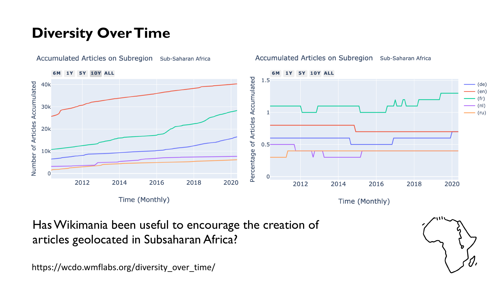
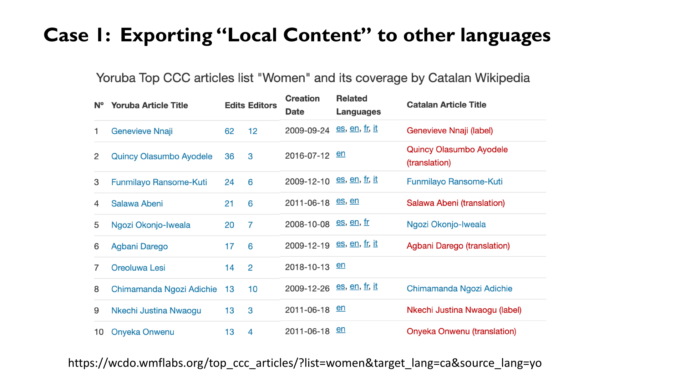

# Wikipedia Diversity Observatory: project and data pipeline

## Executive summary

The Wikipedia Diversity Observatory (WDO, also called WCDO in parts of the repository) is a research project and set of community tools for studying what knowledge is represented within and shared across Wikipedia language editions. Its central dataset identifies **Cultural Context Content (CCC)**: articles in a language edition that relate to the places, people, history and culture connected with that language community. The project also tracks other dimensions of diversity, including geography, gender, ethnicity, religion, language, sexual orientation/LGBT+ topics, and general subject areas.

The repository contains an end-to-end data system, not just a website. Its intended lifecycle is:

1. collect source data from Wikidata, Wikipedia, Ethnologue, language and territory reference files, and Wikimedia dumps;
2. reconcile those sources into reference catalogues and language-territory mappings;
3. build a per-article dataset for each Wikipedia edition;
4. attach diversity signals and classify CCC and several specialized article sets;
5. calculate coverage, overlap, time-series and pageview statistics;
6. export downloadable datasets and copy selected SQLite files to production;
7. serve the prepared data through Dash/Plotly apps and publish selected tables to Meta-Wiki.

The most important distinction for Marta’s database question is:

- **`diversity_categories.db`** is the working/reference database. It holds catalogues and mappings used by the data pipeline: language and territory relationships, language/country/subdivision references, ethnic and religious group metadata, and multilingual category labels.
- **`diversity_categories_production.db`** is intended as a production snapshot made by copying the working database. It is read by the website and some production jobs. The copy function uses a file copy; it does not reshape or transform the tables.
- **Neither file is the main article dataset.** Article-level records are primarily in `wikipedia_diversity.db`; aggregated statistics are primarily in `stats.db`.

This report follows the data from its source, through reference-table construction and article-level labelling, to the website. It is based on the code and documentation in the supplied ZIP. The archive is an older repository snapshot (its files date to November 2022) and does not contain the production SQLite databases or all required input data. The report therefore explains the system represented in that snapshot, not a verified description of the currently deployed service.

## Contents

1. [Project purpose and core concepts](#1-project-purpose-and-core-concepts)
2. [Data sources by diversity dimension](#2-data-sources-by-diversity-dimension)
3. [Ordered data lineage: source to databases](#3-ordered-data-lineage-source-to-databases)
4. [Database roles and the two diversity-categories files](#4-database-roles-and-the-two-diversity-categories-files)
5. [The central CCC pipeline, step by step](#5-the-central-ccc-pipeline-step-by-step)
6. [Specialized and supporting pipelines](#6-specialized-and-supporting-pipelines)
7. [Statistics, downloadable datasets and publication](#7-statistics-downloadable-datasets-and-publication)
8. [Website architecture and application inventory](#8-website-architecture-and-application-inventory)
9. [Historical run order, cadence and elapsed-time view](#9-historical-run-order-cadence-and-elapsed-time-view)
10. [Inputs, preprocessing and operational requirements](#10-inputs-preprocessing-and-operational-requirements)
11. [Important limitations in this repository snapshot](#11-important-limitations-in-this-repository-snapshot)
12. [What this means for a replacement website](#12-what-this-means-for-a-replacement-website)
13. [External references and historic website examples](#13-external-references-and-historic-website-examples)
14. [Glossary and files consulted](#14-glossary-and-files-consulted)

## 1. Project purpose and core concepts

### 1.1 Why the Observatory exists

Wikipedia is produced by separate language communities. Their editions are related, but they do not contain the same articles, and their coverage reflects different editorial histories and local contexts. The WDO aims to make those differences visible and useful: it provides datasets, visualizations and tools that help readers and editors identify content gaps and find articles that could be created or translated.

The repository README describes three broad project outputs: datasets, visualization sites/statistics, and ways to point out opportunities to improve coverage. The papers included in the archive frame this as measuring cultural and knowledge gaps across language editions. The research paper on the CCC method reports historical manual evaluation on 40 languages, with average precision of 0.92 and recall of 0.95. Those are findings from that paper and period; they are not a guarantee about the current code or current data.

### 1.2 Cultural Context Content (CCC)

CCC is the central WDO concept. It is an estimate of the articles in a Wikipedia language edition that relate to the geographical and cultural context of the language and its editors. A language’s context can span more than one country and can include territories where it is official, regional, indigenous or otherwise spoken. It can include topics well beyond geography: people, institutions, events, traditions, food, politics, arts and other cultural subjects.

CCC is **not** a single Wikidata property, nor does the code simply equate CCC with “articles about the country where the language is spoken.” It is assembled from multiple signals: territorial mappings, Wikidata relations, geolocation, article titles, category paths and links between articles. The code first records signals and potential candidates, then estimates the final CCC label.

### 1.3 Three levels of data that are easy to conflate

- **Reference/catalogue data:** what languages, territories, diversity groups and labels exist, and how they are mapped. This is the main role of `diversity_categories.db`.
- **Article-level data:** one row per article, with identity fields and signals/labels. This is mainly `wikipedia_diversity.db`.
- **Aggregated data:** counts, rates, intersections and time series used by dashboards. This is mainly `stats.db`.

The website consumes all three kinds of data. A replacement site cannot reproduce every page from the diversity-categories database alone.

## 2. Data sources by diversity dimension

The project does not have one universal “diversity source.” Each dimension has its own source model. Some dimensions have a reference catalogue plus article-level signals; others rely on a curated seed and category crawl; some combine both. The table separates **the source of the concept/group**, **the article-level signal**, and **the processing step** so those roles are not mixed up. It also includes supporting analysis features such as time, popularity, images and editor activity; those are useful for diversity analysis but are not themselves identity categories.

| Dimension / analysis feature | Source of entities, groups or reference context | Article-level evidence in the code | Where/how it is processed |
|---|---|---|---|
| Language and language communities | Wikidata language entities and Wikipedia-project metadata; Ethnologue language names, country presence, status and language characteristics; ISO 639-3 language codes and macrolanguage tables; WALS codes/glottocodes where available; Wikimedia language-edition codes; project-maintained language/territory mapping. | Article Qitems and language-related Wikidata properties; Wikipedia edition and sitelinks; strong/weak language relations; article context from the language-territory mapping. | `languages_territories_mapping.py` harmonizes sources into language and territory catalogues. `content_retrieval.py` labels language relationships. The resulting article features and mappings are read by CCC selection and statistics. |
| Geography and territories | Curated language-territory mapping; Ethnologue’s language-by-country/location data; Wikidata countries and subdivisions with ISO 3166 / ISO 3166-2, names and languages; `country_regions.csv`; country/region and subdivision reference files. | Wikidata coordinates, country/location/territorial entity relations; reverse geocoding; matching article territory to language context; country/subdivision and regional codes. | Mapping is normalized and enriched in `languages_territories_mapping.py`; article features are assigned in `content_retrieval.py`; some CCC clues are computed in `content_selection.py`. |
| Gender | Wikidata `people_properties`, using property P21 for entities identified as people (the code checks instance-of Q5); a fixed set of gender Qitems is also used when assembling multilingual category labels. | The gender Qitem attached to a person/article in the language edition. In some downstream classifiers, gender is also an auxiliary signal for identifying biographies or relevant group content. | `content_retrieval.py` labels gender on per-language article tables; `wikilanguages_utils.get_store_diversity_categories_labels()` resolves labels and page titles across languages; gender-gap apps use the result/statistics. |
| Ethnic groups and peoples | Wikidata instance/subclass graph and ethnic-group relations. The code treats classes including ethnic group (Q41710), people (Q2472587), diaspora community (Q1467740), nationality (Q231002), ethnoreligious group (Q11197007) and tribe (Q133311) as roots for the catalogue. It supplements this with country, religious-group, language and time relations in Wikidata. The code derives a “minoritized language” marker from the Ethnologue/ISO language-country mapping and status rules. | Direct Wikidata ethnic-group relations for biographies; group membership, country, religion, native/strong language, language used and dates; for broader articles, title keywords, category distance, and incoming/outgoing links to known group articles. | `wikipedia_diversity.py` builds the ethnic-group catalogue in `diversity_categories.db`; `content_retrieval.py` labels ethnic-group and supra-ethnic-group relations; `ethnic_groups_content_selection.py` combines seed evidence and a classifier to select articles about a group. |
| Religious groups and religion | Wikidata `religious_group_properties`, combined with instance/subclass relations. `wikipedia_diversity.py` identifies religious-group classes and English sitelinks/page titles; the category-label builder includes religious-group Qitems. | Religious affiliation of people and religion/religious-group/topic relations on articles, as available in the Wikidata-derived tables. | Religious group reference table in `diversity_categories.db`; article fields are labelled by `content_retrieval.py`; group intersections are calculated in `stats_generation.py`; a religious-groups gap app visualizes aggregate results. |
| Sexual orientation | Wikidata sexual-orientation properties, including P91; partner/spouse relations combined with the genders of the two people; a list of orientation Qitems for multilingual labels. | Explicit orientation property and inferred orientation from partner gender. The code normalizes some Qitems into broader categories. | `content_retrieval.py` populates `sexual_orientation_property` and `sexual_orientation_partner`; `stats_generation.py` calculates intersections; gender/LGBT-oriented pages use these fields. The inference from partners is a heuristic and must not be treated as self-identification. |
| LGBT+ topic content | The local-language page title/label for the Wikidata LGBT item Q17884 is stored as a seed keyword by `store_lgbt_label()`. This is distinct from the fixed Qitem list used for the diversity-label catalogue. | LGBT-related biographies, keyword matches, category graph reached from keyword-matching categories, links to/from already identified LGBT articles, and article features such as gender/orientation. | `lgbt_content_selection.py` reads page and category-link dumps, crawls category levels, measures links, then classifies articles per language and updates the general article database. It writes a separate `lgbt_content.db`. |
| General topics | Wikidata-derived topic/property tables in `wikidata.db`. The code explicitly processes topics such as religion, folk, monuments/buildings, earth, music, sports/teams, food, paintings, glam, books, clothing/fashion, industry, medicine, time intervals and geography-related entities. | Wikidata topic relations and, for temporal topics, start/end dates. | `content_retrieval.py` labels topic columns; `stats_generation.py` aggregates topic coverage; `topical_coverage_app.py` visualizes the results. |
| Experimental group-identity sets (overlapping) | Existing labels in `wikipedia_diversity.db`, catalogue Qitems/labels, language-specific names, and Wikipedia category/title/link structure. | Known examples copied as ground truth, language-specific keywords, category crawling and links. | `group_identities_selection.py` is a broader experimental framework; the more developed ethnic-group and LGBT pipelines have their own scripts and databases. This is an implementation framework, not a separate diversity dimension. |
| Time and historical coverage | Wikidata time properties and article start/end intervals; article creation and revision dates from Wikipedia/MediaWiki history. | Article start/end time, creation month, last edit/discussion, and time-window membership. | `content_retrieval.py`, `article_features.py` and `stats_generation.py` produce time features and monthly/accumulated results. |
| Article popularity/attention | Wikimedia pageview/pagecount dumps; Wikirank source used by the code; article metadata. | Pageviews and derived article-level popularity. | `article_features.py` adds pageviews; `stats_generation.py` aggregates them; `last_month_pageviews_app.py` displays recent attention. |
| Images and visual material | Wikipedia image links and Commons/image metadata available to the pipeline. | Number of images, linked image titles and Qitem-to-image mappings. | `article_features.py` builds image-related data and `images.db`; visual apps use the production image copy. |
| Editor and community diversity | MediaWiki History/revision data, editor/account metadata, language and CCC article membership. | Editor activity, language participation, account age/flags, retention, timing and community-level measures. | Separate scripts: `editor_diversity.py`, `editor_engagement.py`, `community_health_metrics_export_csv_v2.py`; the field guide is `docs/mediawiki_history_fields.xlsx`. |

### 2.1 Four examples: how a source becomes a diversity label

The dimensions do not all follow the same recipe. These examples separate the origin of a concept, the evidence attached to an article, and the later selection or aggregation step:

1. **Language community and CCC:** Ethnologue, ISO files, Wikidata, regional references and the curated WDO mapping help define a language’s territories. For an article, geolocation, title keywords, Wikidata relations, category paths and links provide evidence. The CCC classifier combines those signals to estimate the article set for that language edition.
2. **Ethnic group:** Wikidata class/subclass and group relations seed the catalogue of groups. A biography may have a direct ethnic-group relation, while a broader article about a group may instead be found through localized title keywords, category paths and links. The group catalogue and the per-language article set are separate outputs.
3. **Gender:** the main article-level source is Wikidata’s gender property P21 for entities treated as people. Retrieval writes that relation as a field; downstream views aggregate it. This is a structured-data measure, so it reflects the coverage and modeling choices of Wikidata and should not be presented as a complete or self-identified account of gender.
4. **LGBT+ identity versus LGBT+ topic content:** a person’s sexual-orientation relation (including P91 and partner-based heuristics) is a person-level semantic feature. The LGBT+ topic set is a separate article-selection pipeline: it starts from the local-language title for Wikidata’s LGBT item, then uses localized category names, category crawling, links and other article features. One answers “what articles are about LGBT+ topics?”; the other asks “what orientation-related data is attached to this person/article?”

These distinctions matter when rebuilding the site: similarly named charts can be based on different populations and evidence. A page about “women in CCC,” for example, can combine the CCC article set with gender fields, while an LGBT+ articles page uses the specialist topic set. The underlying query and denominator should be documented for each view.

### 2.2 Language and territory sources in more detail

The language-territory mapping is not simply copied from Wikipedia or Wikidata. It is a crosswalk of sources with different identifiers and levels of detail:

1. **Ethnologue names and language-by-country pages.** The code contains functions that scrape an archived Ethnologue site (2019 archive URLs) for language names and pages describing countries/locations, autonyms, alternate names, population, status, classification and other fields. It stores raw rows before normalization.
2. **ISO 639-3/SIL reference files.** The code expects files such as `iso-639-3_20190125.tab` and `iso-639-3-macrolanguages_20190125.tab`. It uses them to bridge Ethnologue language codes to ISO 639-1/2/3, identify macrolanguage/member-language relationships, and add language type/scope.
3. **Wikidata language entities and Wikipedia projects.** SPARQL queries fetch language Qitems, labels, native names, ISO codes and Wikimedia language-edition codes. A project-level table describes Wikipedia editions and their language metadata.
4. **Wikidata countries and subdivisions.** Queries use ISO 3166 and ISO 3166-2 plus country/subdivision labels, native and official names, and language-related properties.
5. **Regional crosswalks.** `country_regions.csv` is joined on country codes to add region, subregion and intermediate region. Other functions use `pycountry` to work with subdivisions and country codes; WALS/Babel/pycountry are mentioned as complementary language/country resources in the code.
6. **Curated language-territory mapping.** The project CSV is the human-readable mapping consumed by the database import function. It carries WDO-specific decisions such as whether a territory is regional, whether a language is indigenous there, and its status/context. The website description explicitly invites community corrections.

These sources need reconciliation: country names do not always match across services, ISO codes are missing for some cases, one language may be spoken in many territories, and Wikimedia’s language code is not interchangeable with each ISO code. The code includes exception dictionaries, code normalization and fallback matching to handle this.

### 2.3 Diversity label catalogue versus article classification

A reference catalogue says **which entities and display labels are in scope**. An article classifier says **which articles belong to a set**. For example:

- A Qitem for an ethnic group can be in the ethnic-group catalogue even if no article in a particular Wikipedia is about that group.
- An article can be selected as about that ethnic group by category crawling or link evidence even if it lacks a direct Wikidata ethnic-group statement.
- A gender or orientation label can be populated directly from Wikidata while an article about LGBT+ topics is selected with a separate keyword/category/link classifier.

Keeping those two operations distinct is necessary for both interpreting results and rebuilding the web.

### 2.4 CCC evidence classes, with a worked example

The detailed WDO method page on Meta-Wiki gives a more explicit taxonomy than the code README. It separates evidence into **reliable CCC**, **potential CCC**, **reliable evidence for another context**, and **potential evidence for another context**. These are feature classes used as input to a final classifier, not four pages the user sees and not four mutually exclusive notions of culture.

| Evidence class | Examples | Why it matters |
|---|---|---|
| Reliable CCC evidence | Article geolocation inside a mapped territory; title contains a local language/territory/demonym keyword; strong Wikidata links to mapped countries, places, language, creators or “part of” entities. | Provides high-confidence positive examples and reliable features. |
| Potential CCC evidence | Category-graph crawl from territory/language keyword categories; weak language relations; affiliations; “has part” relations; links in/out of known CCC articles. | Suggests local relevance, but each signal can also point to broad, indirect or noisy connections. |
| Reliable other-context evidence | Article geolocated in a territory assigned to another language context; strong country/location relation to another mapped context. | Helps avoid assigning every geographically related article to every language. |
| Potential other-context evidence | Category paths or links to another context, and weaker Wikidata properties pointing outside the current mapping. | Adds negative/contextual evidence without claiming that the article is certainly irrelevant. |

The published method page lists representative Wikidata property groups. For example, country relations include P17 (country), P27 (country of citizenship), P495 (country of origin) and P1532 (country for sport). Strong language relations include P37 (official language), P364 (original language of work) and P103 (native language); weaker language relations include P407, P1412 and P2936. The [full method page](https://meta.wikimedia.org/wiki/Wikipedia_Diversity_Observatory/Cultural_Context_Content) has the longer property lists and explanations.

**Worked example — Italian Wikipedia.** The project’s language-territory mapping documentation uses Italian as an example with Italy, Vatican City, San Marino, the Swiss canton of Ticino, Istria County, Piran and Izola. A page geolocated inside one of those mapped territories is a strong local-context clue. A page found only several steps down a category path such as “Performing Arts in England” is weaker: it could be about something local, but category graphs can contain broad or misleading paths. The method page gives a cautionary example where “Wars involving the United States” can lead through “World War II” to German-army articles. That is why category depth, link evidence and other-context evidence matter alongside the seed keyword.

The final model expands from reliable examples to plausible candidates. The repository’s `content_selection.py` builds training data from existing `ccc_binary` labels, converts category paths and multi-valued signals into numeric features, samples negatives, fits a Random Forest, and classifies candidate articles. There is a material version difference to document: the Meta method description says negatives may be sampled up to ten times the positive set; this archive’s code samples six batches for most languages and three for English. Treat the code snapshot as the implementation evidence for this ZIP, and the Meta page as the fuller published explanation of the method.

## 3. Ordered data lineage: source to databases

The following diagram is intentionally organized by **phase and order**, rather than by every function. The boxes identify the source or output type. It shows the two category databases in context.

~~~mermaid
flowchart TD
  subgraph SOURCES[1 · INPUTS]
    direction LR
    W[Wikidata dump and queries]
    P[Wikipedia pages, links and categories]
    L[Ethnologue, ISO, WALS and language files]
    M[Curated language-territory mapping]
    H[Pageview, image and history dumps]
  end
  subgraph REFERENCE[2 · REFERENCE DATABASES]
    direction LR
    WD[(wikidata.db)]
    DC[(diversity_categories.db)]
  end
  subgraph ARTICLES[3 · ARTICLE DATASET]
    direction LR
    WV[(wikipedia_diversity.db)]
    SIG[Per-article features and evidence]
    CCC[CCC decision and specialist labels]
  end
  subgraph RESULTS[4 · DERIVED OUTPUTS]
    direction LR
    ST[(stats.db)]
    SP[Missing CCC, ethnic, LGBT+ and top lists]
    CSV[Downloadable CSV datasets]
  end
  subgraph SERVING[5 · PUBLICATION]
    direction LR
    PROD[Production SQLite snapshots]
    WEB[Dash / Plotly website]
    META[Meta-Wiki pages]
  end
  W --> WD
  W --> DC
  L --> DC
  M --> DC
  P --> WV
  WD --> SIG
  DC --> SIG
  WV --> SIG
  H --> SIG
  SIG --> CCC
  CCC --> WV
  CCC --> ST
  CCC --> SP
  WV --> ST
  ST --> CSV
  ST --> PROD
  SP --> PROD
  DC --> PROD
  WV --> PROD
  PROD --> WEB
  ST --> META
  classDef source fill:#E8F1FB,stroke:#2864A5,stroke-width:2px,color:#12243A
  classDef database fill:#E8F6EF,stroke:#278553,stroke-width:2px,color:#173B29
  classDef process fill:#FFF3D9,stroke:#C57A00,stroke-width:2px,color:#4A3100
  classDef results fill:#F2EAFE,stroke:#7650A5,stroke-width:2px,color:#302048
  classDef publish fill:#FCE8E8,stroke:#B63D3D,stroke-width:2px,color:#4D1E1E
  class W,P,L,M,H source
  class WD,DC,WV,ST database
  class SIG,CCC process
  class SP,CSV results
  class PROD,WEB,META publish
~~~

**How to read it:** follow the numbered bands from top to bottom. Blue nodes are sources, green are SQLite stores, amber is article-level processing, purple is derived output, and red is publication. The key separation is visible: reference data (`diversity_categories.db`), article data (`wikipedia_diversity.db`) and aggregate stats (`stats.db`) are different layers. Arrows show data dependencies, including specialist pipelines that write labels back to the general article dataset.

## 4. Database roles and the two diversity-categories files

### 4.1 Database map

The file names are declared in `src_data/wikilanguages_utils.py`. The table is a conceptual map of the snapshot; not every database is generated in every run or included in this ZIP.

| Database | Main role | Typical consumer/output |
|---|---|---|
| `wikidata.db` | Local structured copy of Wikidata facts used by the pipeline: entity properties, instance/subclass relations, sitelinks, labels and other joins. | Article feature retrieval and group catalogues. |
| `diversity_categories.db` | Working reference database: language/territory relationships, language/country/subdivision catalogues, group catalogues and multilingual labels. | Data pipeline and some apps. |
| `diversity_categories_production.db` | File-copy snapshot of the reference database for production reads. | The language-territory app explicitly reads it. |
| `wikipedia_diversity.db` | Main per-article dataset; one table for each active Wikipedia language edition. | Feature/CCC calculations, statistics and exports. |
| `wikipedia_diversity_production.db` | Published copy of the article dataset. | Website and specialist content tools. |
| `stats.db` | Aggregated counts, ratios, intersections, time periods, topical measures and other metrics. | Dashboard pages and exports. |
| `stats_production.db` | Production copy of the statistics database. | Dashboard pages. |
| `top_diversity_articles.db` | Per-language top-article lists and related features/intersections. | Top CCC and coverage/spread tools. |
| `missing_ccc.db` | Potentially missing CCC article candidates. | Missing CCC tool and exports. |
| `ethnic_groups_content.db` | Group-specific candidate articles and classification evidence. | Ethnic-group article/gap tools. |
| `lgbt_content.db` | LGBT+ candidate articles, seed, category and link evidence, classification. | LGBT+ article/gap tools. |
| `images.db` | Image and Qitem/image lookup tables. | Article cards and visual views. |
| `revision.db`, `imagelinks.db`, per-language temporary SQLite files | Supporting/history or intermediate storage. | Feature processing; often not a user-facing product. |
| `editor_diversity.db`, `editor_engagement.db` | Editor-level and community participation metrics. | Separate community dashboards/analysis. |
| `community_health_metrics_<language>.db` | Per-language community health metrics. | CSV export. |
| `group_identities.db`, `stubs.db` | Experimental group-identity or stub datasets. | Related tools where enabled. |

### 4.2 What is in `diversity_categories.db`?

The code uses this as a **reference and harmonization store**, not as the final article corpus. Table families visible in the code include:

- **Language and project reference:** `all_languages_wikidata`, `wiki_projects`, Ethnologue language name/raw mapping tables, ISO language/macrolanguage crosswalks.
- **Territory reference:** `all_countries_wikidata`, `all_countries_subdivisions_wikidata`, `country_regions`, `language_countries_mapping`, `language_territories_mapping`, `wikipedia_languages_territories_mapping`.
- **Language/territory comparison:** `language_pairs_country_status`, `language_pairs_territory_status`, `wikipedia_language_pairs_territory_status`.
- **Diversity-group catalogues:** `ethnic_groups`, `religious_groups`, and LGBT label-by-language data.
- **Multilingual display lookup:** `diversity_categories_labels_production`, which stores Qitem, local label, local Wikipedia page title, code, English title, language and category label.

The exact complete schema and row counts of the deployed database cannot be recovered from the code archive alone. The list above is the set of table families the checked code creates or queries, not a claim that every historic database version contained precisely these tables.

### 4.3 How the category tables are built, in source order

The provenance order matters. A simplified build sequence is:

1. **Obtain raw language names and language-country facts.** The code can scrape the archived Ethnologue language index and individual language pages. It stores names, autonyms, alternate names, countries/locations, population, status, language development and other raw fields in `ethnologue_languages_names` and `ethnologue_raw_language_countries_mapping`.
2. **Normalize language identities.** It loads ISO 639-3/SIL language and macrolanguage files; matches Ethnologue codes with ISO 639-1/2/3 and Wikimedia language codes; adds language type, scope and macrolanguage membership. WALS/glottocode and other language metadata are used where available.
3. **Build the Wikipedia-project and Wikidata language catalogue.** SPARQL retrieves language Qitems, labels, native labels, ISO codes and Wikimedia codes. The project table combines this with Wikipedia-edition metadata and language/region context.
4. **Obtain country and subdivision reference rows.** Wikidata queries retrieve Qitems, labels, native/official names, language properties and ISO codes P297/P300. Local regional crosswalks and subdivision libraries supply additional geographical classification.
5. **Join language-country facts to territories.** Country-name exceptions, ISO crosswalks, status-code normalization, indigenous/non-indigenous rules, population parsing and region lookup reconcile the sources. The source code explicitly filters some languages by status and marks indigenous cases.
6. **Import the WDO language-territory mapping.** `import_wikipedia_languages_territories_mapping_csv_store_sqlite3()` reads the curated tab-separated mapping, normalizes Wikimedia codes, joins region/subregion/intermediate region from `country_regions.csv`, then writes `wikipedia_languages_territories_mapping`.
7. **Derive ethnic and religious group catalogues.** `wikipedia_diversity.py` queries Wikidata-derived tables for group classes, relations and English sitelinks, and stores catalogues in `diversity_categories.db`.
8. **Build local labels for display.** `get_store_diversity_categories_labels()` combines catalogue Qitems, Wikidata labels, article sitelinks/page titles and fixed category Qitems. It drops/recreates `diversity_categories_labels_production` and inserts rows for each selected Wikipedia language.
9. **Publish the reference snapshot.** At the end of the statistics pipeline, `copy_db_for_production(diversity_categories_db, ...)` copies the database file to `diversity_categories_production.db`.

The name `diversity_categories_labels_production` can be confusing: it is a **table inside the working `diversity_categories.db`** in the code shown. It is not the separate SQLite file `diversity_categories_production.db`.

The following source-to-table view makes the provenance explicit:

| Source material | Transformation / decision | Resulting table family in `diversity_categories.db` |
|---|---|---|
| Archived Ethnologue language index and language pages | Extract names, autonyms, alternate names, locations, countries, population and status; retain a raw source table first. | `ethnologue_languages_names`, `ethnologue_raw_language_countries_mapping` |
| ISO 639-3/SIL files and macrolanguage crosswalk; WALS/glottocode when present | Match codes, language type, scope, macrolanguage and linguistic identifiers to the language records. | `language_countries_mapping`, `all_languages_wikidata`, supporting language tables |
| Wikidata language and Wikipedia-project queries / project CSV | Resolve Qitems, Wikimedia codes, ISO codes, native names and language-edition metadata. | `all_languages_wikidata`, `wiki_projects` |
| Wikidata country/subdivision queries | Resolve territorial Qitems, names, official/native labels, language properties and ISO 3166/3166-2 identifiers. | `all_countries_wikidata`, `all_countries_subdivisions_wikidata` |
| Ethnologue language-country rows + ISO name/country crosswalks + regional files | Normalize country names and codes; map language status, indigenous flags, region and subdivision context; preserve project decisions. | `language_countries_mapping`, `language_territories_mapping` |
| WDO-maintained language-territory TSV + `country_regions.csv` | Normalize Wikimedia codes; join geographic region fields; import the curated rows with a composite key. | `wikipedia_languages_territories_mapping` |
| Wikidata property and instance/subclass tables plus English sitelinks | Select ethnic/religious group classes and attach relations or English page titles. | `ethnic_groups`, `religious_groups` |
| Wikidata `labels` + Wikipedia page titles/Qitems + preceding catalogues + fixed category Qitems | For each language, select local label/page title for each relevant Qitem and save a display lookup. | `diversity_categories_labels_production` |
| Completed working category database | Copy the SQLite file, without reshaping the data. | File `diversity_categories_production.db` |

A further implementation detail: category names are not fully consistent in the code. The label-building function’s declared category list includes forms such as `LGBT` and `country_subdivision`, while inserts elsewhere use forms such as `lgbtq`, `countries_subdivision` and `indigenous_groups`. A replacement should normalize these values in a documented enum or lookup table rather than assume the legacy strings are uniform.

### 4.4 Why there are two files

`diversity_categories.db` is used as the writable/preparation copy while the data pipeline builds or refreshes reference tables. `diversity_categories_production.db` is the read-facing copy expected by production code. The utility function derives the production name by replacing `.db` with `_production.db`, then calls `shutil.copyfile()`.

This is a file-level snapshot, not a data transformation. In principle, the two files have the same table contents at the instant of copying. They can differ later if the working copy changes and the production copy is not refreshed. The archive does not contain either file, so it is impossible to compare a real pair or verify their actual freshness.

## 5. The central CCC pipeline, step by step

### Step 1 — Create the Wikidata and article inventory

**Main file:** `src_data/wikipedia_diversity.py`.

Its visible `main()` calls `wd_dump_iterator()`, updates geolocation and instance/subclass information, creates the per-language article database, inserts page IDs/titles/Qitems, and stores ethnic/religious group reference data.

`create_wikipedia_diversity_db()` creates one table for every active Wikipedia language edition. Each row represents an article. The schema starts with general identity/date fields and then has groups of columns for geography, people, CCC signals, general topics, LGBT/ethnic topics and article characteristics. The actual table is deliberately broad so later jobs can fill columns incrementally.

**Inputs:** Wikidata dump and derived local tables; active Wikipedia language editions and replica access; language/territory metadata.

**Output:** `wikidata.db`, the initial structure/inventory in `wikipedia_diversity.db`, and group reference data in `diversity_categories.db`.

### Step 2 — Attach direct semantic and geographic features

**Main file:** `src_data/content_retrieval.py`.

The intended feature block reads Wikidata facts and article sitelinks, matches entities to per-language pages and fills article columns. Examples include gender, religious group, religion and general topic relations; sexual orientation from a property or partner evidence; ethnic and supra-ethnic group relations; start/end times; coordinates; country/location; strong language; creator; part-of; and title keywords.

For CCC-oriented geography, the code compares article Qitems and location relations with territories associated with the language. It also uses reverse geocoding and ISO mappings. The output is a set of article-level **signals**. At this stage, a page may have a country link or matching keyword without being selected as final CCC.

**Inputs:** `wikidata.db`, `wikipedia_diversity.db`, `diversity_categories.db`, per-language page mappings and territory definitions.

**Output:** feature columns updated in the per-language tables and multilingual labels stored in the category database.

### Step 3 — Find potential CCC articles

**Main file:** `src_data/content_selection.py`.

This step generates candidate signals that cannot be captured by a single Wikidata relation:

- starts from context-related categories and crawls subcategories;
- records how far an article is from a seed category;
- compares inlinks/outlinks to known CCC or geographically related articles;
- uses weak language links, affiliations, “has part” and other Wikidata relations;
- tracks alternative/other-context CCC clues.

Category and page-link SQL dumps may be parsed into temporary per-language SQLite files. These files can be very large; the script deletes some temporary databases when finished.

**Output:** potential features such as category crawl level, keyword matches, link counts and proportions, and possible CCC relations. These are candidate evidence, not the final binary label.

### Step 4 — Train/apply the CCC classifier

The same `content_selection.py` module prepares known-positive/reference examples, samples likely negatives, constructs training/testing data, then uses a Random Forest classifier. It calculates a final `ccc_binary` result and related fields such as `main_territory` and `num_retrieval_strategies`.

The `docs/manual assessment/` folder is part of the methodological history: it contains manual assessment scripts, language samples, F1/precision/recall worksheets and inter-rater agreement (kappa) calculations. These documents show that classification quality was checked against human judgements. They also show that settings and results varied by language and model version; they are not a current model card for every language.

**Output:** final CCC indicator and supporting fields in each language’s article table.

### Step 5 — Enrich article records with descriptive metrics

**Main file:** `src_data/article_features.py`.

This adds pageviews, images, Wikirank, references, featured-article status, interwiki and sister-project properties, article/revision history and language of first timestamp. It uses extra sources such as pagecount dumps and MediaWiki History, so it has independent input and freshness requirements.

The features help characterize articles and power ranking/monitoring pages. Not all are inputs to CCC classification.

### Step 6 — Create focused article sets

Specialized flows identify articles beyond the general CCC label. The major ones are described in [Section 6](#6-specialized-and-supporting-pipelines): missing CCC, ethnic-group content, LGBT+ content, top diversity lists, group identities and stubs. Some update the general article database; others keep a separate database that apps query.

### Step 7 — Aggregate for comparisons and time series

**Main file:** `src_data/stats_generation.py`.

This script calculates statistics from per-article labels and sets: counts and rates within a language, coverage of a set by another language, shared/common content, CCC intersections, people/geography/group intersections, topic coverage, temporal increments, pageviews and top-article list intersections.

The stats layer converts a massive article-level dataset into smaller tables the web can query quickly. A chart showing “coverage” or “spread” is generally based on these aggregates rather than scanning every article on each page request.

## 6. Specialized and supporting pipelines

### 6.1 Ethnic-group articles

**File:** `src_data/ethnic_groups_content_selection.py`.

The ethnic-group catalogue begins from Wikidata class/subclass data, then includes metadata related to countries, religious group, time intervals and languages. The code marks groups associated with minoritized languages using the language-country/status mapping. For article selection, it gathers several forms of evidence:

1. biographies already labelled with ethnic-group membership in the general dataset;
2. title keywords matching group names;
3. category crawling from group-related categories;
4. links between articles and known group articles;
5. a per-group binary classifier that uses CCC membership, gender/biography clues, keyword evidence, category levels and link counts.

The result is stored in `ethnic_groups_content.db` and can update ethnic-group topic labels in `wikipedia_diversity.db`. The script contains manual pauses and an early return in the snapshot, so the intended final update/copy sequence is not necessarily reachable as written.

### 6.2 LGBT+ articles

**File:** `src_data/lgbt_content_selection.py`.

The language-specific seed is obtained from the local Wikipedia title for Q17884 (LGBT), stored in `LGBT_label_languages`. The pipeline parses page and category-link dumps, finds categories whose names match that localized seed, crawls subcategory levels, and gathers article link evidence. It also reads gender and sexual-orientation features from the main dataset. A classifier produces the final per-language `lgbt_binary` selection, stored in `lgbt_content.db` and copied back into the general article dataset.

This is distinct from simply retrieving Wikidata sexual orientation. One is an article-topic set; the other is a person/article semantic feature.

### 6.3 Missing CCC

**File:** `src_data/missing_ccc_selection.py`.

This pipeline looks for content related to a language’s context that may exist in other language editions but is missing locally. It uses territory and language-pair/status relationships, candidate article features and, in the intended fuller flow, keywords, geolocation, country/location, language, part-of and creator properties. It transfers features across language pairs and stores candidate results in `missing_ccc.db` for the corresponding app.

The current `main()` in the archive has numerous commented-out steps and a language-loop starting at a particular code; this is a historical working state, not a clean all-language rebuild recipe.

### 6.4 Top diversity / top CCC articles

**File:** `src_data/top_diversity_selection.py`.

This creates per-language top-article lists, updates their features and titles from sitelinks/labels/old translations, and calculates intersections used by top-CCC coverage/spread apps. Some production-copy calls are commented out in the visible `main()`, so the presence of the production database name does not prove the archive refreshes that copy automatically.

### 6.5 Group identities

**File:** `src_data/group_identities_selection.py`.

This appears to be a broader/experimental framework for ethnic, religious and sexual-orientation group identity article sets. Its comments describe copying ground-truth articles from the general dataset, then adding keyword, category-crawl and link evidence before classification. The functions are only partly implemented in this snapshot, and `main()` pauses for input.

### 6.6 Stubs and data-status tools

`src_viz/stubs_update.py` creates/updates a stub database and publishes stub pages. `data_status_app.py` exposes data freshness/status information. These are related operations but not part of the CCC classifier itself.

### 6.7 Editors and community health

- `editor_diversity.py` parses/uses MediaWiki History and revision records to analyze editor diversity and editing of CCC/content types.
- `editor_engagement.py` computes participation, retention, survival/drop-off and time-based/community metrics.
- `community_health_metrics_export_csv_v2.py` exports per-language community-health database metrics to CSV.
- `docs/mediawiki_history_fields.xlsx` documents source fields such as event type, timestamp, user identity/flags, registration and edit counts and how some feed derived features.

These are separate user/community analytics and should not be mistaken for another table inside `wikipedia_diversity.db`.

## 7. Statistics, downloadable datasets and publication

### 7.1 The four time interpretations in `stats_generation.py`

`docs/sets_intersections.xlsx` and comments in `stats_generation.py` describe four time ranges. They answer different questions and should not be merged under a vague label such as “monthly data.”

| Internal term | What it means | Example question |
|---|---|---|
| `accumulated monthly` | An accumulated total at each month over the historical series. | How did the total coverage of a category grow over time? |
| `last accumulated` | The most recent accumulated snapshot, up to the last completed month. | What is the current estimated coverage? |
| `monthly created` | Articles created in each individual month over the historical series. | How many related articles were created in each month? |
| `last month` | Articles created in the most recent month being reported. | What was created last month? |

### 7.2 What an intersection represents

The statistics code constructs named sets (for example, one language’s Wikipedia, CCC, a topic, biographies, a group, geolocated content, or a top list) and computes overlaps, totals or proportions. Depending on the function, an intersection can measure:

- a set’s size in one Wikipedia;
- the proportion of one language edition that is CCC or belongs to a topic;
- how many of one language’s culturally relevant articles appear in another language;
- how much a cross-language reference list is covered by an edition;
- how content creation or pageviews vary over time.

The sets/intersections workbook is the historical catalogue of these functions and their intended meaning. For a new site, preserving the original numerator, denominator, set definition and period is more important than preserving a chart type.

### 7.3 Outputs

At the end of the visible `stats_generation.py` main flow, the code copies `stats.db`, `wikipedia_diversity.db` and `diversity_categories.db` to production versions and calls `extract_wikipedia_diversity_tables_to_files()`. This creates the handoff from batch calculation to website/download consumption.

The README says datasets and SQLite files were published monthly. The ZIP includes six compressed per-language CCC CSV samples. Their columns include identity and dates; territory and CCC labels; retrieval evidence; other-context links; article size/references/images; edits/editors/discussions/pageviews; Wikidata property and interwiki counts; and featured-article status.

The CSV exports and database snapshots serve different needs:

- CSV: portable analysis and reuse outside the site;
- production SQLite: fast application queries and cross-table joins;
- working SQLite: building/updating pipeline state.

## 8. Website architecture and application inventory

### 8.1 Application architecture

The web code uses Flask, Dash, Dash Bootstrap Components and Plotly. `src_viz/dash_apps.py` defines shared resources: database path, current period, language/territory context, selectors, navigation, footer and Flask app. App modules under `src_viz/apps/` define individual routes and callbacks. Many query production SQLite databases and then update tables/graphs in response to user filters.

This means the old web is coupled to the batch pipeline’s database schemas and hard-coded deployment paths. Some app modules open their SQLite files during import/startup, which makes missing production databases a startup problem rather than a graceful per-page error.

### 8.2 App inventory from the sitemap and source tree

The sitemap workbook documents the intended site sections, while source filenames reveal additional tools. The following is a functional reading of those names and their visible database queries; it is not confirmation that every route remained live at the last deployment.

| App/source file | User-facing purpose |
|---|---|
| `home_app.py` | Landing page. |
| `language_territories_mapping_app.py` | Searchable language-to-territory mapping. |
| `cultural_context_content_app.py` | List/summary of Wikipedia editions by CCC. |
| `ccc_coverage_spread_apps.py` | Compare CCC coverage and sharing across language editions. |
| `common_ccc_app.py` | Explore CCC articles common to selected languages. |
| `incomplete_ccc_app.py` | Find incomplete CCC records or missing information. |
| `missing_ccc_app.py` | Explore possible articles missing from an edition’s CCC. |
| `search_ccc_app.py` | Search and filter CCC articles. |
| `visual_ccc_app.py` | Visual article exploration, including images and article attributes. |
| `top_ccc_app.py` | Browse top CCC article lists by source/target language or territory. |
| `top_ccc_coverage_spread_apps.py` | Coverage/spread of top article lists across languages or countries. |
| `geography_gap_app.py` | Compare geographic coverage, territories and maps. |
| `gender_gap_app.py` | Explore gender-related coverage. |
| `ethnic_groups_gap_app.py` | Compare ethnic-group coverage. |
| `ethnic_groups_articles_app.py` | Browse articles about ethnic groups. |
| `religious_groups_gap_app.py` | Compare religious-group coverage. |
| `lgbtq_gap_app.py` | Compare LGBT+ coverage. |
| `lgbtq_articles_app.py` | Browse LGBT+ articles. |
| `diversity_over_time_app.py` | Explore diversity measures over time. |
| `time_gap_app.py` | Compare coverage of time-related content. |
| `time_articles_app.py` | Browse time-associated articles. |
| `topical_coverage_app.py` | Compare general topic coverage. |
| `last_month_pageviews_app.py` | Compare recent pageviews, including CCC and other sets. |
| `recent_changes_diversity_app.py` | Inspect recent edits/articles by diversity category. |
| `data_status_app.py` | Show data availability/status. |
| `stubs_app.py` | Explore stub articles. |

The sitemap also has Meta-Wiki pages for the project, methods, questions, CCC coverage/spread, geolocated articles, and related documentation. `meta_update.py` and `stubs_update.py` contain automated publishing code; those require credentials and external write access.

### 8.3 Database dependencies by app family

- Mapping and language context: `diversity_categories_production.db`.
- Coverage, spread, topic and time aggregations: `stats_production.db`.
- Article search/detail and current per-article labels: `wikipedia_diversity_production.db`.
- Top lists and their intersections: `top_diversity_articles_production.db` and statistics tables.
- Group-specific lists: the ethnic-group, LGBT+ or missing-CCC production data stores.
- Images: image production database and, in some visual flows, Wikipedia page/image data.

The new site’s data contract should specify which database/table powers each page and whether it uses a historical aggregate or current article detail.

### 8.4 What the historical interface was for

The screenshots below come from the project presentation PDF bundled with the repository, not from a fresh capture of a live site. They preserve examples of the old interface and are useful for understanding product intent; they should not be treated as current UI specifications.

**Monitoring example:** the “Diversity Over Time” page juxtaposes accumulated article counts and percentages for a selected region, and frames them around a question about whether an event encouraged article creation. This shows how the site connected a chart to a community-facing question.

*Archived presentation screenshot, slide 16. Source: `research_publications/presentation_wikipedia_diversity_observatory.pdf` in the supplied repository snapshot.*

**Actionable gap example:** the top-articles table compares a Yoruba women’s CCC list with Catalan Wikipedia. It shows source article, edits, editors, creation date, other language links and the corresponding Catalan title/status. This illustrates how a measurement can lead directly to a translation or article-creation task.

*Archived presentation screenshot, slide 19. Source: `research_publications/presentation_wikipedia_diversity_observatory.pdf` in the supplied repository snapshot.*

## 9. Historical run order, cadence and elapsed-time view

### 9.1 Historical dependency order

`docs/execution_time_and_order.xlsx` describes a rough monthly dependency order for the central flow:

1. `wikipedia_diversity.py` — Wikidata and per-article base;
2. `content_retrieval.py` — direct features;
3. `content_selection.py` — potential CCC and final classifier;
4. `article_features.py` — additional article characteristics;
5. `stats_generation.py` — aggregate statistics and production snapshots;
6. `missing_ccc_selection.py` — downstream missing-content process; the workbook describes this as quarterly.

Other jobs (language mapping, ethnic/LGBT sets, top lists, editors, images, stubs and Meta-Wiki updates) have their own dependencies and may run on different schedules. The spreadsheet gives historical durations and database sizes, not current capacity requirements.

### 9.2 A time-oriented view of the monthly cycle

This diagram separates the **data period** from the **execution period**. The utility documentation says a dump for month M is used to represent the last fully complete month, commonly M−1. The exact lag depends on which source dumps are available.

~~~mermaid
sequenceDiagram
  autonumber
  participant Sources as Wikimedia / Wikidata sources
  participant Ingest as Ingest and normalize
  participant Article as Article features and CCC
  participant Stats as Statistics and exports
  participant Prod as Production snapshots
  participant Site as Website / Meta-Wiki
  rect rgb(232,241,251)
    Note over Sources,Ingest: 1 · Collect source period; determine latest complete reporting month
    Sources->>Ingest: Dump, replica, reference files
    Ingest->>Ingest: Assign cycle year-month and log completed functions
  end
  rect rgb(255,243,217)
    Note over Ingest,Article: 2 · Build article records and diversity signals
    Ingest->>Article: Qitems, pages, territories, group catalogues
    Article->>Article: Retrieve signals, find candidates, classify CCC
    Article->>Article: Add pageviews, images and history when available
  end
  rect rgb(242,234,254)
    Note over Article,Stats: 3 · Aggregate by set and period
    Article->>Stats: Article labels and features
    Stats->>Stats: accumulated / last accumulated / monthly created / last month
    Stats->>Stats: Export per-edition datasets
  end
  rect rgb(252,232,232)
    Note over Stats,Site: 4 · Publish a consistent snapshot
    Stats->>Prod: Copy selected working SQLite files
    Prod->>Site: Dash apps read production tables
    Stats->>Site: Meta-Wiki tables updated by publishing jobs
  end
~~~

### 9.3 Monthly timeline and historical/cumulative outputs

The four statistical periods are not four separate ingestion runs. They are four views over the data history. In the diagram, A, B and C are example months and `nA`, `nB` and `nC` stand for the number of newly created matching articles in each month; they are symbols, not measured WDO values.

~~~mermaid
flowchart LR
  subgraph PERIOD[1 · Monthly article creation]
    direction LR
    A[Month A nA new articles] --> B[Month B nB new articles] --> C[Month C nC new articles]
  end
  subgraph VIEWS[2 · Four statistical views]
    direction TB
    CREATED[Monthly created A: nA · B: nB · C: nC]
    ACCUM[Accumulated monthly A: nA · B: nA+nB · C: nA+nB+nC]
    SNAP[Last accumulated latest total through C]
    LAST[Last month nC only]
  end
  A -. each month's increment .-> CREATED
  B -. each month's increment .-> CREATED
  C -. each month's increment .-> CREATED
  A --> ACCUM
  B --> ACCUM
  C --> ACCUM
  ACCUM --> SNAP
  C --> LAST
  classDef month fill:#E8F1FB,stroke:#2864A5,stroke-width:2px,color:#12243A
  classDef history fill:#F2EAFE,stroke:#7650A5,stroke-width:2px,color:#302048
  classDef snapshot fill:#E8F6EF,stroke:#278553,stroke-width:2px,color:#173B29
  class A,B,C month
  class CREATED,ACCUM history
  class SNAP,LAST snapshot
~~~

The source documentation states that the new cycle is usually one month behind the dump being processed because the pipeline waits for a complete month. The site should therefore display a data period from the actual snapshot metadata, not infer freshness from the day the website is opened.

## 10. Inputs, preprocessing and operational requirements

### 10.1 Inputs needed for a real rebuild

The following is a functional checklist inferred from imports, queries and paths in the code:

- Wikidata dump and a working build of `wikidata.db`;
- access to Wikipedia language replicas or equivalent local page/category/link data;
- page, categorylinks, pagelinks and possibly other SQL dumps for category crawling and specialist selections;
- MediaWiki History and pageview/pagecount dumps for temporal and popularity features;
- Ethnologue source data or retained snapshots of the extracted tables;
- ISO 639-3/SIL tables, macrolanguage crosswalk, ISO 3166/3166-2 and regional files;
- WALS/glottocode data where used;
- curated language-territory mapping and Wikipedia edition metadata;
- project-specific manual assessment/training/reference sets;
- correct language list, cycle period, local directory configuration and run log;
- when publishing to Meta-Wiki, Pywikibot configuration and write credentials.

Some expected files, including `country_regions.csv`, `wikipedia_language_editions.csv` and ISO files, are referenced by code but are not all present in the ZIP. The live SQLite databases are also absent.

### 10.2 Preprocessing that the code expects

1. Normalize Wikimedia language codes, ISO codes and historical aliases.
2. Link languages to Qitems and Wikipedia sitelinks.
3. Resolve mismatches in country names and map country/subdivision identifiers to ISO codes.
4. Attach regions and subregions from a separate crosswalk.
5. Distinguish country-level, regional and subdivision territories.
6. Convert article titles and multi-valued property fields to the conventions used in SQL joins.
7. Derive language status and indigenous/minoritized indicators from raw sources and project rules.
8. Preserve the reporting-cycle date and avoid mixing a new source snapshot with older feature tables.
9. Curate and maintain mappings that are not safely inferable from a single external source.

### 10.3 Runtime and infrastructure assumptions

The code contains fixed paths such as `/srv/wcdo/databases/`, `/srv/wcdo/datasets/` and `/srv/wcdo/dumps/`, and uses Wikimedia replica hostnames and public dump paths. `requirements.txt` is old and largely unpinned. The scripts expect SQLite, MySQL client access, substantial disk space, network access to sources and sometimes long-running processes across many languages. The execution-time workbook historically describes very large databases and multi-hour jobs.

A site-only rebuild can avoid rerunning these steps if reliable, versioned outputs are recovered. Rebuilding the data itself requires much more than installing the Python packages.

## 11. Important limitations in this repository snapshot

The archive is valuable for understanding the design, but several details prevent treating it as a clean current runbook:

- It contains source code, docs and sample CSVs, but no actual `.db` files for the two category databases or the main article/statistics stores.
- Several input files used by code are not included in the archive.
- `languages_territories_mapping.py` has its documented orchestration calls inside a triple-quoted string; its visible `main()` is effectively empty.
- `content_retrieval.py` has a visible `main()` that runs a topic-reset loop and returns before the full feature blocks below it. The intended blocks exist, but that `main()` does not call them as written.
- `stats_generation.py` calls `input('')` three times before copying databases and exporting files, so unattended execution can pause there.
- `ethnic_groups_content_selection.py` also pauses for input and returns before a later push/copy section in the visible main flow.
- `missing_ccc_selection.py` has many feature-generation calls commented out and starts a loop at a specific language in the snapshot.
- Some production-copy operations for auxiliary databases are commented out; declared production filenames do not prove an automated refresh path exists.
- README, source and sitemap use old/varied names and deployment domains (`WCDO`, `WDO`, Toolforge/Cloud VPS). These are historical references, not verified current hosting details.
- The official Meta-Wiki method page describes the conceptual CCC taxonomy in greater detail than this code snapshot. Where implementation and method descriptions differ (for example, the negative-sampling ratio), this report calls out the mismatch instead of silently treating them as identical.
- Requirements are unpinned and include legacy Dash components, so the old environment may not install or run unchanged today.

Accordingly, distinguish three things when handing this project to a new developer: **the intended method**, **the code present in this snapshot**, and **the currently available production data/service**. They may not be identical.

## 12. What this means for a replacement website

A new website can preserve the WDO’s research value without requiring every historic script to run on every page request. The clearest separation is:

1. **Offline data pipeline:** retrieve and normalize source snapshots; compute article labels, specialist sets and aggregates; publish versioned data.
2. **Data contract/API:** provide documented article, language, territory, set and time-series records with source period and method version.
3. **Web application:** display the datasets, provide filters and comparisons, and explain measures and their denominators.

For each view, record:

- the question it answers and the set it represents;
- its grain (article, language, group, territory, month or intersection);
- input table/file and source snapshot date;
- numerator and denominator for every rate;
- meaning of “coverage,” “spread,” “common,” “missing” or “top” for that view;
- filters, default language/time period and treatment of missing labels;
- whether the page reads precomputed aggregates or article-level rows;
- update cadence and last successful data cycle.

A useful migration artifact would be a page-to-data matrix: one row per legacy app, with route, purpose, source database/table, query, filters, expected columns, period semantics and whether to keep, combine or retire the page. The sitemap is a starting point, but source and production availability should be checked before deciding the final set of pages.

The old implementation keeps much of the SQL inside Dash app modules and uses hard-coded filesystem/database paths. A replacement can make the same concepts easier to maintain by versioning datasets, separating ingestion from serving, and documenting stable field names. These are recommendations based on the code structure, not claims about how the old deployment was operated.

## 13. External references and historic website examples

These links are useful complements to the code archive. The official method pages explain the intended research definitions in more depth than the old README; the repository is the reference for the implementation in the supplied snapshot.

- [Wikipedia Diversity Observatory on Meta-Wiki](https://meta.wikimedia.org/wiki/Wikipedia_Diversity_Observatory) — mission, categories, dashboards and project links.
- [Cultural Context Content: definitions and method](https://meta.wikimedia.org/wiki/Wikipedia_Diversity_Observatory/Cultural_Context_Content) — territory mapping, CCC evidence classes, machine-learning method, dataset fields and historical examples.
- [Language-Territories Mapping on Meta-Wiki](https://meta.wikimedia.org/wiki/Wikipedia_Diversity_Observatory/Language_Territories_Mapping) — description of the reference mapping and its fields.
- [WDO source repository](https://github.com/marcmiquel/wcdo) — code, docs and sample datasets represented by the archive.
- [Wikipedia Cultural Diversity Dataset: A Complete Cartography for 300 Language Editions](https://arxiv.org/abs/1901.07999) — research description of CCC datasets and features.
- [The Wikipedia Diversity Observatory: A Project to Identify and Bridge Content Gaps in Wikipedia](https://doi.org/10.1145/3412569.3412866) — project paper and dashboard purpose.
- [Historical website address referenced by the repository](https://wcdo.wmflabs.org/) — retained as a historical link. It did not load in this review, so the screenshots above are taken from the bundled 2020 presentation instead of the live site.

The Italian territories and category-crawl example in Section 2.4 come from the official Meta-Wiki method page. The two screenshots above are from the presentation included in the archive and show historic interfaces. Each is an example of product intent, not evidence that the same page, values or behavior are available today.

## 14. Glossary and files consulted

### Glossary

- **Wikipedia language edition:** one language-specific Wikipedia project, identified in code by a code such as `cawiki`.
- **Qitem:** Wikidata entity identifier used to connect a concept across languages.
- **CCC:** Cultural Context Content, the estimated set of articles connected with a language community’s cultural/geographical context.
- **Feature/signal:** a field that describes an article or provides evidence for classification.
- **Candidate/potential CCC:** an article identified by one or more retrieval strategies before final classification.
- **Coverage:** how much of a defined reference set is represented in an edition (exact denominator depends on the statistic).
- **Spread:** how a set is distributed or shared across editions.
- **Intersection:** the overlap of two defined sets, often reported as a count or ratio.
- **Working database:** the writable/calc copy used while building or refreshing data.
- **Production database:** a published snapshot intended for application reads.

### Repository materials used

This explanation draws on the supplied repository archive, especially:

- `README.md` — project purpose, CCC overview, tools and historical publishing model;
- `src_data/wikilanguages_utils.py` — database names, paths, period/log helpers, territory loaders, category labels and production-copy logic;
- `src_data/languages_territories_mapping.py` — Ethnologue/Wikidata/ISO/WALS-related source collection, normalization and imports;
- `src_data/wikipedia_diversity.py` — Wikidata processing, per-language article schema and ethnic/religious catalogues;
- `src_data/content_retrieval.py` and `src_data/content_selection.py` — article signals, candidate strategies and CCC classification;
- `src_data/article_features.py` and `src_data/stats_generation.py` — enrichment, aggregations, exports and production copies;
- `src_data/missing_ccc_selection.py`, `top_diversity_selection.py`, `ethnic_groups_content_selection.py`, `lgbt_content_selection.py`, `group_identities_selection.py` — focused content sets;
- `src_data/editor_diversity.py`, `editor_engagement.py`, `community_health_metrics_export_csv_v2.py` — community/editor analytics;
- `src_viz/dash_apps.py`, `src_viz/apps/*.py`, `src_viz/meta_update.py`, `src_viz/stubs_update.py` — website and publication code;
- `docs/execution_time_and_order.xlsx` — historical run order, dependencies, durations and database sizes;
- `docs/sets_intersections.xlsx` — statistical set/intersection definitions;
- `docs/wdo_sitemap.xlsx` — website and Meta-Wiki page inventory;
- `docs/mediawiki_history_fields.xlsx` — history-dump field dictionary and uses;
- `docs/manual assessment/` — classifier assessment script, F1 sheets, kappa sheets and language samples;
- `docs/wikipedia_language_territories_mapping.csv` and `datasets_sample/` — sample mapping and downloadable dataset examples;
- `research_publications/` — research papers and presentation on CCC, cultural gaps and the Observatory.

The source archive contains historical descriptions and code, but not all source inputs or output databases. Before using this document as an operational runbook, compare it with the current data store, scripts and deployment configuration.
